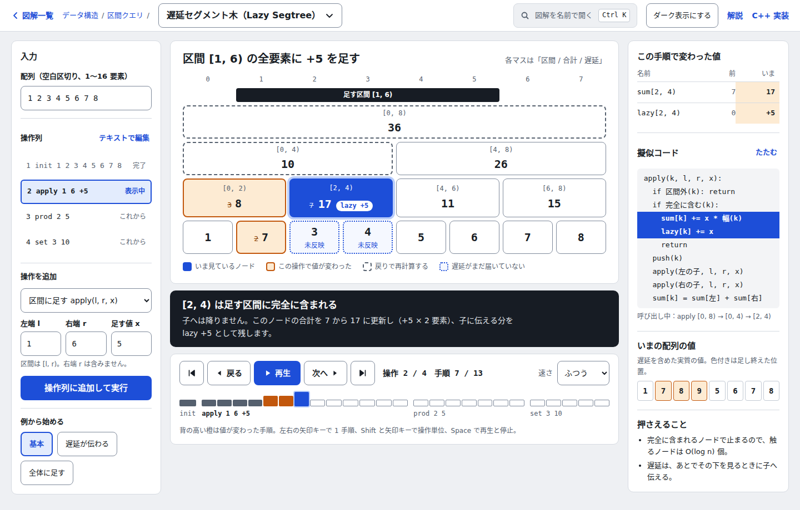

# 図解 UI の設計メモ

図解ページを作り直すときの共通仕様です。2026-11-24 に、プレーヤー型（図が主役）とデバッガ型（操作列・タイムライン・コード）を統合した案を採用しました。現状の問題点、進め方、進捗は [issue #20](https://github.com/marc2825/cp_library/issues/20) にあります。

実装はまだ始まっていません。既存のページは古い UI のままです。

## 見本

[design/mock.html](design/mock.html) をブラウザで開くと、Lazy Segtree の区間加算（手順 7 / 13）を例にした見本を確認できます。操作できない静止画です。色や寸法は下の配色変数を正とし、見本から写さないでください。



## 画面の構成

```text
┌──────────────────────────────────────────────────────────────────────────┐
│ 図解一覧  分野 / 小分野 /  [図解名 ▾]      [図解を名前で開く] [表示切替] 解説 実装 │
├───────────────┬──────────────────────────────────┬───────────────────────┤
│ 入力           │ 図                                │ この手順で変わった値   │
│  初期値         │  見出し（いま行っている操作）       │  名前 / 前 / いま      │
│  操作列         │  図本体                           │ 擬似コード（ある場合） │
│  操作を追加     │  凡例                             │ 補助の表示             │
│  例から始める   ├──────────────────────────────────┤ 押さえること           │
│               │ 説明（いまの手順の題と本文）        │                       │
│               ├──────────────────────────────────┤                       │
│               │ 再生バー・タイムライン・速さ        │                       │
└───────────────┴──────────────────────────────────┴───────────────────────┘
```

| 領域 | 置くもの | 決まり |
|---|---|---|
| ヘッダー | 一覧へのリンク、現在地、図解名、検索、表示切替、解説と実装へのリンク | 図解名のボタンから同じ分野の図解へ切り替える。タブは使わない（モードが多いと折り返して図を押し下げるため） |
| 入力（左） | 初期値、操作列、操作の追加フォーム、例 | JSON を手で書かせない。詳しくは「入力」 |
| 図（中央） | いまの操作を表す見出し、図、凡例 | 画面でいちばん広い領域にする。図の上に統計タイルを置かない |
| 説明（図の直下） | いまの手順の題と 1〜3 文の本文 | 図と再生バーの間に置き、視線を動かさずに読めるようにする。`aria-live="polite"` を付ける |
| 再生バー | 前の操作、戻る、再生、次へ、次の操作、現在位置、速さ、タイムライン | 並びと文言は全ページで同じにする。詳しくは「操作」 |
| 状態（右） | この手順で変わった値、擬似コード、補助の表示、押さえること | 「この手順で変わった値」は必ず出す。それ以外は図解ごとに任意 |

1440×900 で、図・説明・再生バーがスクロールなしに同時に見えることを目安にします。

### 狭い画面

幅 900px 未満では 1 列にし、**図 → 説明 → 再生バー → 入力 → 状態** の順に並べます。入力を図より先に置きません。図が横にはみ出す場合は図の領域だけを横スクロールにします。

## 状態の表し方

色だけで区別しません。線の種類、塗り、ラベルを併用します。

| 状態 | 表し方 |
|---|---|
| いま見ている要素 | `--now` で塗りつぶし、文字は `--on-now`。外側に薄い輪 |
| この操作で値が変わった | `--changed-soft` の地と `--changed` の実線の枠。旧値を取り消し線で残す |
| あとで再計算・再訪する | `--muted` の破線の枠 |
| 更新がまだ届いていない（遅延など） | `--now` の点線の枠と、短いラベル |
| まだ触れていない | `--line-strong` の実線の枠 |

グラフの辺、木の枝、配列のセルにも同じ決まりを当てます。図解に固有の状態を足すときは、凡例に載せ、色以外の手がかりを必ず付けます。

## 配色変数

共通の CSS に次の変数を置き、各ページの CSS や JS に色を直書きしません。`prefers-color-scheme` に従い、ヘッダーの表示切替で上書きできるようにします（一覧ページと同じ `data-theme` 方式）。

| 変数 | 役割 | ライト | ダーク |
|---|---|---|---|
| `--bg` | ページの地 | `#eef0f3` | `#12161c` |
| `--surface` | パネルの地 | `#ffffff` | `#1a2029` |
| `--surface-2` | コード欄など一段沈める地 | `#f3f4f6` | `#222a35` |
| `--ink` | 本文 | `#171c24` | `#e8edf2` |
| `--muted` | 補助の文字 | `#55606e` | `#a3b1c2` |
| `--line` | 区切り線（装飾） | `#d5dae1` | `#303a48` |
| `--line-strong` | 入力欄・図の要素の枠 | `#7f8a9b` | `#7a889c` |
| `--now` | 現在位置、主ボタン、リンク | `#1d4ed8` | `#7ab8ff` |
| `--on-now` | `--now` の上の文字 | `#ffffff` | `#0b1420` |
| `--now-soft` | 選択中の行の地 | `#e3ecfd` | `#16304f` |
| `--changed` | 変更の枠、タイムラインの印 | `#c2570c` | `#f5c261` |
| `--changed-soft` | 変更の地 | `#fdebd3` | `#3a2f17` |
| `--changed-ink` | 取り消し線を引いた旧値 | `#8a4104` | `#f5c261` |
| `--caption-bg` | 説明欄の地 | `#171c24` | `#222a35` |
| `--caption-ink` | 説明欄の文字 | `#ffffff` | `#e8edf2` |

計測したコントラスト比（WCAG の計算式）：

- ライト：`--muted` と `--surface` 6.39、`--on-now` と `--now` 6.70、`--now` と `--now-soft` 5.64、`--changed-ink` と `--changed-soft` 6.34、`--line-strong` と `--surface` 3.49。
- ダーク：`--ink` と `--surface` 13.90、`--muted` と `--surface` 7.50、`--on-now` と `--now` 8.92、`--changed` と `--changed-soft` 7.99、`--line-strong` と `--surface` 4.55。

色を足すときは、文字 4.5:1 以上、枠や線 3:1 以上を満たすことを確かめます。

## 文字

- 外部通信なしで開けることを保つため、Web フォントは読み込みません。
- 文章：`"Hiragino Sans", "Yu Gothic UI", "Meiryo", "Noto Sans JP", system-ui, sans-serif`。
- 数値・添字・コード：`ui-monospace, "Cascadia Code", Menlo, Consolas, monospace`。
- 最小 12px。本文 14px、説明欄の題 17px、図の中の値 20px を基準にします。
- 英大文字に字間を空けた小見出しや、内容を表さない標語の見出しは使いません。ページの見出しは図解名、図の見出しは「いま行っている操作」にします。

## 操作

再生バーのボタンは、左から **前の操作へ／戻る／再生／次へ／次の操作へ** の順に固定します。再生中は「再生」を「停止」に変えます。押せるものは 44px 以上の大きさにします。

| キー | 動作 |
|---|---|
| `←` `→` | 1 手順戻る・進む |
| `Shift` + `←` `→` | 前・次の操作の先頭へ |
| `Space` | 再生と停止 |
| `Home` `End` | 最初・最後の手順へ |
| `Ctrl` + `K` または `/` | 図解を名前で開く |

入力欄にフォーカスがある間は、これらのキーを奪いません。

**タイムライン**は操作ごとに区切り、1 手順を 1 つの目盛りで表します。済んだ手順、値が変わった手順（背を高くして `--changed`）、現在の手順（いちばん背が高く `--now`）、これからの手順（枠だけ）を区別します。目盛りを押すとその手順へ移動します。

**速さ**は「ゆっくり／ふつう／速い」の 3 段階です。`prefers-reduced-motion: reduce` のときは図の動きを切り、状態だけを切り替えます。

**URL** には図解・入力・操作列を残し、再読み込みや共有で同じ状態を開けるようにします。`file://` で `history.replaceState` が使えない場合も、図解そのものは動くようにします。

## 入力

- 入力は「初期値」と「操作列」（1 行に 1 操作）に分けて持ちます。
- 操作は、種類を選んで値を入れるフォームから追加します。操作列は「テキストで編集」に切り替えて直接書き換えることもできます（例：`apply 1 6 +5`）。
- 一度に全体を処理するアルゴリズム（最短路、DP など）は、操作列を持たず、初期値のフォームと実行ボタンだけにします。
- 各図解に 2〜4 個の例を用意し、「例から始める」から 1 回の操作で読み込めるようにします。例の名前は、何が起きるかを表します（「基本」「遅延が伝わる」など）。
- JSON を手で編集する入力は廃止します。入力の項目は図解ごとの定義からフォームを組み立てます。
- 入力の誤りは、その入力欄のそばに「何が違うか」と「どう直すか」を出します。
- 結果を JSON のまま出しません。表、図、または文で示します。

## 文言

- 一覧へのリンクは「図解一覧」に統一します。
- ボタンは、押すと起きることを書きます（「操作列に追加して実行」「例を読み込む」）。
- 説明欄の題は、その手順で分かったこと・決まったことを 1 文で書きます（「[2, 4) は足す区間に完全に含まれる」）。本文は理由と結果を書きます。
- 区間の表記、添字の始まり、用語は、同じ分野のページで揃えます。

## 任意の部品

用意できた図解にだけ出します。ない図解では領域ごと出しません。

- **擬似コード**：10〜15 行。いまの手順に対応する行を `--now` で塗ります。再帰するものは、下に呼び出し中の経路を 1 行で添えます。655 図解すべてに一度に付けることはせず、主要な図解から足します。
- **補助の表示**：図とは別の見方が理解を助けるときに置きます（遅延を反映した実質の配列、優先度付きキューの中身など）。
- **押さえること**：その図解で持ち帰る要点を 2〜3 個。

## 実装するときの注意

- 共通の枠（ヘッダー、説明欄、再生バー、タイムライン、キー操作、表示切替）は 1 か所に実装し、各図解は「入力の定義」「手順の列」「図の描き方」だけを持つ形にします。
- ページは分野ごとにまとめ直し、`b_1_6` のような作業バッチ単位のページは残しません。URL が変わるページは、[entries.json](entries.json) と一覧、`docs/` からのリンクを同じ変更で直します。
- 各ページの browser test（`verify/visualizations/*_browser_test.mjs`）は要素の id に依存しています。載せ替えるときは id を保つか、同じ変更でテストを直します。
- 変更後は `make site` で一覧と `html/` を作り直し、`make check-site` を通します。

## 採用しなかった案

- **教科書型**（文章を読み進め、例を選んで「次の手順へ」を押すだけの構成）は、自由に入力して確かめる使い方に向かないため見送りました。「例から始める」と、平易な説明文の書き方だけを取り入れています。
